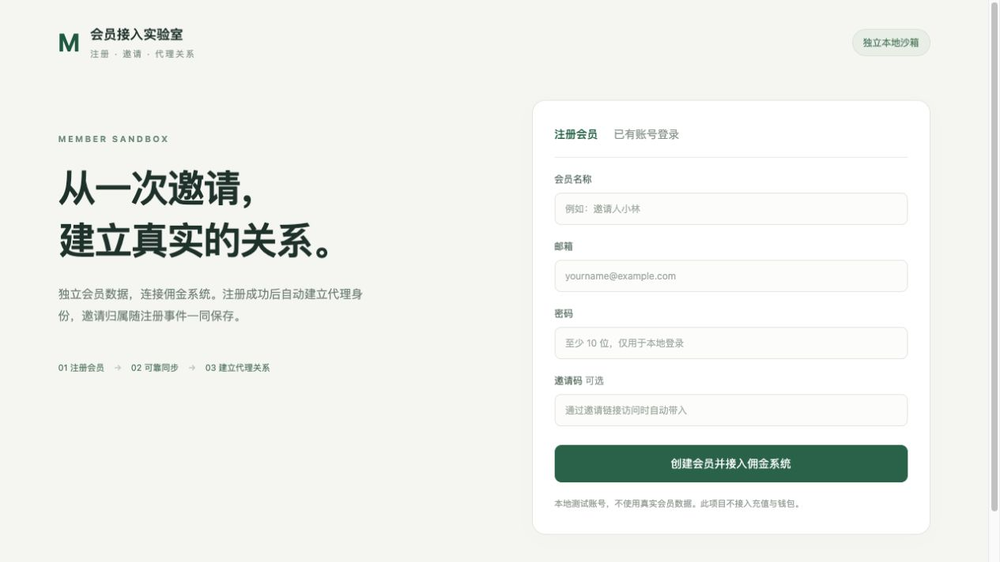

# ex-member-sandbox 工程说明

模拟会员系统，用于本地注册、邀请归属、会员身份认证及与佣金服务的自动接入联调。当前目录名为 ex-member-sandbox-identity，远程项目名仍为 ex-member-sandbox。

## 目录

- [系统关系](#系统关系)
- [职责与页面](#职责与页面)
- [注册与邀请流程](#注册与邀请流程)
- [配置与运行](#配置与运行)
- [数据边界与验证](#数据边界与验证)

## 系统关系

当前由五个独立工程协作，运营身份与会员身份分开管理，代理后台与运营中心不融合页面。

| 工程 | 主要负责 | 当前本地入口 | 数据和权限边界 |
|---|---|---|---|
| ExCommission | 佣金规则、代理关系、奖励、结算、审批、报表 | API `127.0.0.1:19286`；worker `19287` | 业务库、资金事务、幂等及业务授权 |
| ExCommission-Web | 代理后台和会员代理页面；同源 BFF | [19486](http://localhost:19486/) | 浏览器会话与转发；不直接决定资金结果 |
| ex-ops-identity | 运营账号认证、站点角色、会话及审计 | 身份 API `127.0.0.1:19587` | 独立运营库；不复用会员账号 |
| ex-ops-identity-web | 运营人员账号、角色和站点管理页面 | [19586](http://127.0.0.1:19586/) | 只转发运营管理白名单；不承载代理页面 |
| ex-member-sandbox | 模拟会员注册登录、邀请及可靠事件投递 | [19386](http://127.0.0.1:19386/)；身份 `19387` | 独立会员库；不是正式会员平台 |

本地目录 `ex-member-sandbox-identity` 对应远程仓库 `ex-business/ex-member-sandbox`，不是额外的第六个工程。以上端口是本次联调实例，不覆盖各工程示例配置的默认端口。

```text
Ops browser -> Ops Web :19586 -> Ops Identity :19587 -> Ops DB
                                      ^
                                      | verify account / site / roles
Admin browser -> Business Web :19486 --+--> ExCommission :19286 -> Business DB
Member browser -> Business Web :19486 -> Member Identity :19387 -> Member DB
                                             ^
Member registration :19386 -> signed outbox --+--> ExCommission
ExCommission worker :19287 -> calculation / settlement / delivery
```

运营身份服务只提供账号、站点和角色；每个业务系统自行映射业务权限。其他尚未接入的业务系统不能因此视为已自动接通。

## 职责与页面



| 能力 | 本工程负责什么 |
|---|---|
| 注册登录 | 独立会员账号、密码验证及会话；不使用运营账号 |
| 邀请 | 保存注册时的邀请码，并可靠投递首次邀请关系 |
| 身份接入 | 供受信BFF交换和校验会员身份，支持撤销及过期 |
| 资料展示 | 稳定展示ID及成功登录审计；可按私有快照导出给代理报表 |
| 联调来源 | 结合现有来源适配工具验证会员事实及代理接入；不替代真实充值、投注和资金渠道 |

## 注册与邀请流程

```text
Invite link -> Register member -> SQLite member + outbox transaction
Outbox -> signed registration -> ExCommission -> member mapping + agent + relation
BFF member login -> Identity listener -> member token -> own affiliate endpoints
```

本地注册201只代表会员已创建；接入状态需要继续查询。PENDING/PROCESSING表示等待或处理中，SUCCEEDED表示上游确认，BLOCKED表示业务拒绝，不得丢弃邀请码后重新注册来伪装成功。

同一注册事件使用固定event_id、原始载荷和幂等键。临时故障退避重试，业务4xx保留拒绝原因；租约防止旧投递覆盖新结果。普通会员的奖励计算、审核和佣金账簿仍由ExCommission负责。

## 配置与运行

Go1.25、独立SQLite。根目录 `config.example.json` 复制到私有 `.local/config.json` 后填写已授权的固定地址、站点和接入密钥，权限0600。

```sh
mkdir -p .local
go build -o .local/member-server ./cmd/server
.local/member-server -config .local/config.json
```

示例默认端口与当前联调不同；本次实例19386为会员Web/来源服务，19387为独立身份监听。`IdentityListen` 配置身份地址，`MemberPortalURL` 指向会员代理页面。数据库、密码材料、身份接入配置和导出快照不提交。

主要目录：`internal/app`实现会员事务、接入及身份；`internal/app/web`提供页面；`cmd/affiliate-profile`提供受控资料快照导出。完整字段及身份协议继续参考原README，不另造一套配置。

## 数据边界与验证

运营人员通过19587认证，普通会员通过本工程身份服务认证；相同浏览器操作不意味着账号或权限互通。成功登录时间/IP取实际连接，经过BFF时不伪造终端公网IP；未提供的VIP/头像不伪造。

既有注册、邀请、身份撤销/过期、资料导出及并发测试保留。本次跨仓会员回归验证两个账户钱包500/50最小单位保持不变，重复领取409，报表CSV可下载；这些是隔离联调数据，不是实际资金支付。

【涉及其他业务】本工程提供会员来源及身份，ExCommission负责代理奖励和账务；本轮仅增加说明文档与截图，不修改会员程序。真实外部充值、投注、设备识别和资金渠道尚需目标环境接入验收。
